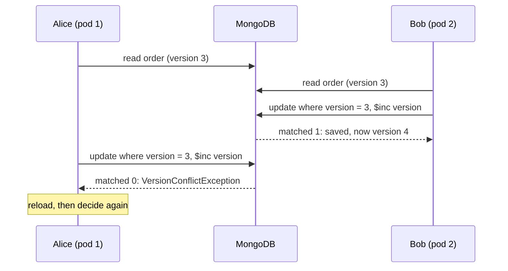

# Optimistic Locking and Who-Columns for MongoDB

[](LICENSE)


Many pods can write the same MongoDB documents. This library prevents lost updates. It also records who created
each document and who changed it last (the "who-columns").

**The key idea: each insert and each update to the collection goes through one writer, `OptimisticLockingWriter`.**
This writer does two jobs:

- **Optimistic locking.** Each update filters on the expected version and increments it. One atomic `updateOne` does
  both. There are no lost updates.
- **Who-column safety.** The writer sets the who-columns in the same write. An insert sets all four. An update sets
  the last-modified pair. The writer rejects a change to a who-column.

**What breaks it:** an insert or update that does not use the writer breaks both jobs. Examples are a script, a
migration and an edit in Compass. Such a write must set the version and the who-columns, as the writer does.

The repository has two parts:

- **`com.example.optimistic`** is the generic writer, `OptimisticLockingWriter<K>`. You can use it on any collection.
- **`com.example.paymentorders`** is an example: a payment-order service that uses the generic writer.

**Status:** tested locally on a single-node MongoDB 9.0.4 replica set in Docker (Testcontainers).

## Why

Two users edit the same order from different pods.

- **The problem: MongoDB makes each update to one document atomic.** But it does not check for a change by a
  different user between the read and the write.
- **Without a check, the second save overwrites the first.** Nobody sees an error. This is a **lost update**.
- **A lock in memory cannot prevent this,** because the saves come from different pods.
- **The fix is optimistic locking.** The application holds no lock between its read and its write.
- **The version in the update filter does the check.** The MongoDB manual gives this advice: "include the expected
  current value in the update filter".
- **The result:** the caller gets a conflict, not a silent overwrite.



Reference: MongoDB manual,
[Atomicity and transactions](https://www.mongodb.com/docs/manual/core/write-operations-atomicity/).

## How it works

1. Each document has a version (a `long`). An insert sets it to 1.
2. The caller keeps the version that it read. The caller sends this version with the write.
3. One `updateOne` filters on `_id` and that version. The same operation does `$inc` of the version by 1.
4. A match count of 1 is a success.
5. A match count of 0 starts one read. This read finds the cause:
   - the document is missing;
   - the version is different (a conflict);
   - the precondition failed.
6. After a conflict:
   - a user reloads the document and decides again;
   - a system job calculates the change again from the new document;
   - nobody sends the old change with the new version without a check.

```java
// Simplified. OptimisticLockingWriter.update adds the who-columns, the operator allow-list and the error mapping.
UpdateResult result = collection.updateOne(
        and(eq("_id", id), eq("_documentMeta.version", expectedVersion), precondition),
        combine(inc("_documentMeta.version", 1L), changes));   // changes last: combine writes into the first
if (result.getMatchedCount() == 0) {
    Document current = collection.find(eq("_id", id)).first();     // the diagnosis read
    // null → DocumentNotFoundException
    // version != expectedVersion → VersionConflictException
    // same version → PreconditionFailedException
}
```

## Who-columns

The who-columns are the second job of the writer.

- **There are four fields at the document root:** `_createdDate`, `_createdBy`, `_lastModifiedDate` and
  `_lastModifiedBy`.
- **An insert** sets all four from one instant.
- **An update** sets the last-modified pair. It does this in the same `updateOne` that increments the version.
- **The writer never writes the created pair after the insert.**
- **The who-columns record the last writer.** They do not keep a history.
- **The version sets the order of the writes.** The dates come from the clock of the pod. They are for people.
- **The writer owns its system fields:** `_id`, the version (default `_documentMeta.version`) and the four
  who-columns. The writer rejects a change or an insert that names one of these fields.

## Features

- **One round trip on success.** The diagnosis read occurs only after a zero match.
- **A diagnosis with one read.** After a zero match, the caller gets the cause: not found, a version conflict or a
  failed precondition.
- **Each infrastructure failure tells you the result for the data:**
  - `NotWrittenException`: the write did not occur. Try again later.
  - `MaybeWrittenException`: the write possibly occurred. Reload the document before you try again.
  - A subtype gives a known cause. Examples are a timeout, a lost response and an overloaded server
    ([ERRORS.md](ERRORS.md)).
- **No lost updates under load.** The tests race separate clients against each other. A lost-update oracle checks
  the result.
- **An operator allow-list.** A change can use only `$set`, `$unset` and `$inc`. Thus `$rename` cannot get to a
  system field.
- **Durable writes.** The writer fixes majority writes and primary reads. A URI cannot make them weaker.
- **UTC only.** The writer reads BSON dates as `Instant`, never as `java.util.Date`. This is true for each client
  that built the collection.
- **System retries.** `updateWithRetry` calculates the change again from the new document. It retries a conflict
  with exponential backoff and full jitter. The writer never retries a user write.
- **Generic.** The `_id` can be of any type. You choose the path of the version (default `_documentMeta.version`).
  You can add a precondition filter, for example a status rule, a guard or a shard key.

## Why not Spring Data's `@Version`?

- **Spring Data MongoDB does the basic case of both jobs.** `@Version` does optimistic locking. `@CreatedBy`,
  `@CreatedDate`, `@LastModifiedBy` and `@LastModifiedDate` set the who-columns.
- **If you use Spring Data, these annotations are enough for the basic case.**
- **This repository uses the plain MongoDB Java driver.** It adds two functions that Spring Data does not have:
  - **It tells the caller why a save failed. It also tells the caller if the write possibly occurred.** The
    versioned `save` of Spring throws one `OptimisticLockingFailureException` for a missing document and for a
    conflict. A possible write has no exception of its own: a write-concern error becomes
    `DataIntegrityViolationException`.
  - **It checks the version on each partial update. It writes only the changed fields.** The `updateFirst` and
    `findAndModify` of Spring increment the version, but they do not put it in the filter.

## Stack

- **Java 25** and **Maven**.
- **The MongoDB Java driver 5.13 (sync).** There is no Spring and no ODM.
- **MongoDB 9.0** in the tests (Testcontainers, `mongo:9.0.4`).

## Quick start

**You need:** JDK 25, Maven and a Docker daemon for Testcontainers.

```sh
git clone https://github.com/ajaygodbole7/mongo-optimistic-lock.git && cd mongo-optimistic-lock
mvn verify                      # all unit and integration tests, against MongoDB 9.0 in Docker (about 1 min)
```

- **Colima users:** Testcontainers needs two environment variables. See
  [ONBOARDING.md §7](ONBOARDING.md#7-running-things).
- **The load test:** see OPERATIONS.md.

## Use it on your own collection

```java
OptimisticLockingWriter<String> widgets = new OptimisticLockingWriter<>(db.getCollection("widgets"));

widgets.insert("w-1", new Document("name", "first"), user);                          // version 1
long v2 = widgets.update("w-1", 1L, null, Updates.set("name", "second"), user);      // null: no precondition

// A system job: read, calculate a derived field again from the fresh document, retry a conflict.
widgets.updateWithRetry("w-1", null,
        doc -> Updates.set("total", doc.getInteger("price", 0) * doc.getInteger("quantity", 0)),
        "svc-pricing", RetryPolicy.defaults());
```

- **PORTING.md tells you which collections are applicable.**
- **It also gives the changes to make and the checks to do before production.**

## The payment-order example

```java
// One per pod, at startup. The pod's database user needs only readWrite.
PaymentOrderRuntime runtime = PaymentOrderRuntime.create(System.getenv("MONGO_URI"), "payments");
runtime.registerShutdownHook(Duration.ofSeconds(20));    // on SIGTERM: refuse new calls, drain, close
PaymentOrderService orders = runtime.service();

ObjectId id = orders.create(newOrder, "alice");                          // version 1
long v2 = orders.amend(id, 1L, Map.of("currency", "USD"), "alice");      // version 2
long v3 = orders.submit(id, v2, "alice");                                // version 3
```

- **The `user` argument is the verified identity of the caller,** for example the JWT subject. It never comes from
  the request body.
- **The pods do not install the validator.** A deployment step installs it one time for each release
  ([OPERATIONS.md, "Validator deployment"](OPERATIONS.md#validator-deployment)).

## Handling a conflict

A `VersionConflictException` means that a different writer changed the document after your read. Reload the
document with `orders.get(id)` (with the generic writer, `writer.read(id)`). Then select one option:

- **Show the user.** Return 409 with the current document. Use this for a user edit.
- **Calculate the change again** from the current document (`updateWithRetry`). Use this for a system job. On
  `RetriesExhaustedException`, put the work back in the queue.
- **Merge.** Send your change with the new version. Use this only if the other write did not change your fields:
  each field that you changed must still have its base value.
- **Drop the change.** Use this if you do not need the change now.

CONFLICTS.md gives the details. It shows the check before a merge, the merge traps and the version over HTTP. It
also shows how to retry after an unknown result.

## Errors

Callers get typed exceptions, not raw driver exceptions. ERRORS.md gives each exception and the action to do.

- **`VersionConflictException`:** reload, then decide again.
- **`DocumentNotFoundException`, `PreconditionFailedException`:** tell the caller. Do not retry.
- **`TransientDataAccessException`:** on `MaybeWrittenException`, reload first. On `NotWrittenException`, try again
  later.
- **`RetriesExhaustedException`:** the system job puts the work back in the queue.

## When not to use it

- **Hot counters and balances.** Each increment conflicts with the other increments. Use `$inc` with a guard. Put
  the counter in a separate collection that has no version and does not use this writer.
- **Rules across documents.** The guarantee is for one document. The writer has no transactions.
- **Append-only data.** Nobody updates events and logs, so they need no version.
- **Writes that do not use the writer.** Each insert and update to the collection must go through the writer. If
  not, the write must set the version and the who-columns, as the writer does.

[PORTING.md §3](PORTING.md#3-does-the-pattern-fit-your-collection) has the full table, with the action for each case.

## Documentation

- **[ONBOARDING.md](ONBOARDING.md):** learn the code in 20 minutes, before you change it.
- **[CONFLICTS.md](CONFLICTS.md):** handle a conflict or an unknown result. It gives each option, the check before a
  merge and its traps.
- **[ERRORS.md](ERRORS.md):** find each exception and the action to do.
- **[PORTING.md](PORTING.md):** use the writer on a different collection.
- **[OPERATIONS.md](OPERATIONS.md):** configure the service, monitor it, shut it down and do a load test.
- **[DESIGN.md](DESIGN.md):** read the reason for each decision.
- **[SPEC.md](SPEC.md):** find the requirements and the test IDs. SPEC.md is the contract.

## Contributing

- **Start with [ONBOARDING.md](ONBOARDING.md).** [Section 9](ONBOARDING.md#9-making-common-changes) tells you how to
  make a change. [Section 10](ONBOARDING.md#10-rules-you-must-not-break) gives the rules.
- **The code was made with Claude Code from SPEC.md.** CLAUDE.md contains the instructions for the agent.

## License

Apache License 2.0. See [LICENSE](LICENSE).
