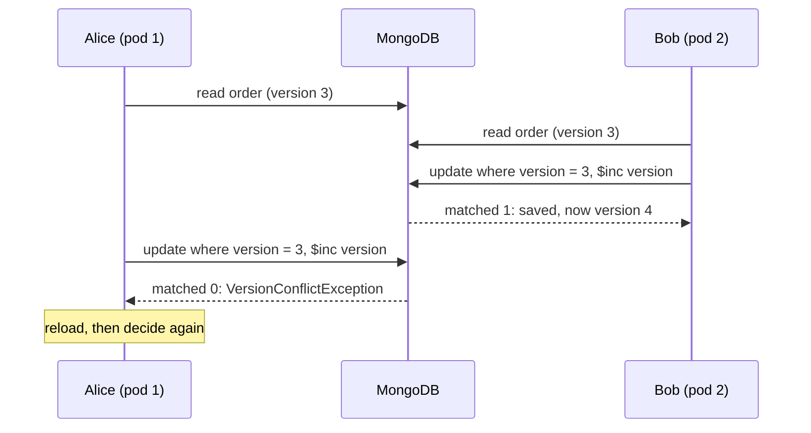

# Optimistic Locking and Who-Columns for MongoDB

[](LICENSE)


Stops lost updates, and stamps who created and last changed each document (the "who-columns"), when many pods write
the same MongoDB documents.

**The key idea: every insert and update to the collection goes through one writer, `OptimisticLockingWriter`.** That
one funnel gives you both jobs:

- **Optimistic locking.** Each update filters on the expected version and increments it, in one atomic `updateOne`.
  No lost updates, no locks, no transactions.
- **Who-column safety.** The writer stamps the who-columns in the same write: all four on an insert, the last-modified
  pair on an update. It rejects any change that touches them.

**What breaks it:** an insert or update that bypasses the writer (a script, a migration, an edit in Compass) breaks
both. It must go through the writer, or set the version and the who-columns itself, as the writer does.

The repository has two parts:

- **`com.example.optimistic`** is the generic writer, `OptimisticLockingWriter<K>`. You can use it on any collection.
- **`com.example.paymentorders`** is a worked example: a payment-order service built on the generic writer.

**Status:** tested locally, against a single-node MongoDB 9.0.4 replica set in Docker (Testcontainers).

## Why

Two users edit the same order from different pods.

- **The problem: MongoDB makes each update atomic on one document,** but it does not check what the other user
  changed in between. Without a check, the second save silently overwrites the first: a **lost update**.
- **An in-memory lock cannot help,** because the saves come from different pods.
- **The fix: optimistic locking, which does not lock the document.** The application holds no lock between its read
  and its write.
- **The version in the filter does the check.** This is MongoDB's own advice: "include the expected current value in
  the update filter".
- **The result:** a silent overwrite becomes a conflict that the caller sees.



Reference: MongoDB manual,
[Atomicity and transactions](https://www.mongodb.com/docs/manual/core/write-operations-atomicity/).

## How it works

1. Each document has a version (a `long`). An insert sets it to 1.
2. The caller keeps the version that it read, and sends it with the write.
3. One `updateOne` filters on `_id` and that version. In the same operation, it does `$inc` of the version by 1.
4. A match count of 1 is a success.
5. A match count of 0 needs one read to find out why:
   - the document is missing;
   - the version is different (a conflict);
   - the precondition failed.
6. On a conflict:
   - a user reloads and decides again;
   - a system job calculates the change again from the new state;
   - nobody sends the old change with the new version without a check.

```java
// Simplified. OptimisticLockingWriter.update adds the who-columns, the operator allow-list and the error mapping.
UpdateResult result = collection.updateOne(
        and(eq("_id", id), eq("_documentMeta.version", expectedVersion), precondition),
        combine(inc("_documentMeta.version", 1L), changes));   // changes last: combine writes into the first
if (result.getMatchedCount() == 0) {
    Document current = collection.find(eq("_id", id)).first();     // the diagnosis read
    // null → DocumentNotFoundException
    // version != expectedVersion → VersionConflictException
    // same version → PreconditionFailedException
}
```

## Who-columns

The who-columns are the writer's second job.

- **Four fields at the document root:** `_createdDate`, `_createdBy`, `_lastModifiedDate` and `_lastModifiedBy`.
- **An insert** sets all four from one instant.
- **An update** sets the last-modified pair in the same `updateOne` that increments the version.
- **The created pair** is never written after the insert.
- **They record the last writer**, not a history.
- **The version orders writes.** The dates come from the pod's clock and are for people.
- **The writer owns six field names:** `_id`, `_documentMeta` and the four who-columns. It rejects a change or an
  insert that names one of them.

## Features

- **One round trip on success.** The diagnosis read happens only after a zero match.
- **A one-read diagnosis.** A zero match tells the caller which case applies: not found, a version conflict, or a
  failed precondition.
- **An `outcomeUnknown` flag on each infrastructure failure:**
  - `false`: the write did not happen, so retry later.
  - `true`: the write may have happened, so reload before you retry.
- **No lost updates under load.** The tests check it with races between separate clients and a lost-update oracle.
- **An operator allow-list.** A change can use only `$set`, `$unset` and `$inc`, so not even `$rename` can reach a
  system field.
- **Durable writes.** Majority writes and primary reads are pinned in the writer, so a URI cannot make them weaker.
- **UTC only.** The writer reads BSON dates as `Instant`, never as `java.util.Date`, whatever client built the
  collection.
- **System retries.** `updateWithRetry` calculates the change again from the fresh document, and retries a conflict
  with exponential backoff and full jitter. The writer never retries a user write.
- **Generic.** Any `_id` type, and an optional precondition filter: a status rule, a guard or a shard key.

## Why not Spring Data's `@Version`?

- **Spring Data MongoDB covers the basic case of both jobs:** `@Version` for optimistic locking, and `@CreatedBy`,
  `@CreatedDate`, `@LastModifiedBy` and `@LastModifiedDate` for the who-columns.
- **If you already use Spring Data,** these annotations are sufficient for the basic case.
- **This repository uses the plain MongoDB Java driver,** and adds what the annotations do not give you on their own:
  the one-read diagnosis, the `outcomeUnknown` flag, pinned durability, protected system fields and system retries.

## Stack

- **Java 25** and **Maven**.
- **The MongoDB Java driver 5.13 (sync).** No Spring, no ODM.
- **MongoDB 9.0** in the tests (Testcontainers, `mongo:9.0.4`).

## Quick start

**You need:** JDK 25, Maven, and a Docker daemon for Testcontainers.

```sh
git clone https://github.com/ajaygodbole7/mongo-optimistic-lock.git && cd mongo-optimistic-lock
mvn verify                      # all unit and integration tests, against MongoDB 9.0 in Docker (about 1 min)
```

- **Colima users:** [ONBOARDING.md §7](ONBOARDING.md#7-running-things) has the two environment variables that
  Testcontainers needs.
- **The load test:** OPERATIONS.md.

## Use it on your own collection

```java
OptimisticLockingWriter<String> widgets = new OptimisticLockingWriter<>(db.getCollection("widgets"));

widgets.insert("w-1", new Document("name", "first"), user);                          // version 1
long v2 = widgets.update("w-1", 1L, null, Updates.set("name", "second"), user);      // null: no precondition

// A system job: read, calculate a derived field again from the fresh document, retry a conflict.
widgets.updateWithRetry("w-1", null,
        doc -> Updates.set("total", doc.getInteger("price", 0) * doc.getInteger("quantity", 0)),
        "svc-pricing", RetryPolicy.defaults());
```

PORTING.md tells you which collections fit, what to change, and what to check before you go live.

## The payment-order example

```java
// One per pod, at startup. The pod's database user needs only readWrite.
PaymentOrderRuntime runtime = PaymentOrderRuntime.create(System.getenv("MONGO_URI"), "payments");
runtime.registerShutdownHook(Duration.ofSeconds(20));    // on SIGTERM: refuse new calls, drain, close
PaymentOrderService orders = runtime.service();

ObjectId id = orders.create(newOrder, "alice");                          // version 1
long v2 = orders.amend(id, 1L, Map.of("currency", "USD"), "alice");      // version 2
long v3 = orders.submit(id, v2, "alice");                                // version 3
```

- **The `user` argument** is the verified identity of the caller, for example the JWT subject. It never comes from
  the request body.
- **The pods do not install the validator.** A deployment step does it once per release ([OPERATIONS.md,
  "Validator deployment"](OPERATIONS.md#validator-deployment)).

## Handling a conflict

A `VersionConflictException` means that a different writer changed the document after you read it. Reload it with
`orders.get(id)` (`writer.read(id)` with the generic writer), then choose:

| Option | When |
|---|---|
| **Show the user:** return 409 with the current document | A user edit |
| **Recompute** the change from the current document (`updateWithRetry`) | A system job (requeue on `RetriesExhaustedException`) |
| **Merge:** send your change with the new version | The other write did not change your fields: each field that you changed still has its base value |
| **Drop** the change | It is no longer needed |

CONFLICTS.md gives the details: the check before a merge, the merge traps, the version over HTTP, the usual error,
and how to retry after an unknown outcome.

## Errors

Callers get typed exceptions, not raw driver exceptions. ERRORS.md lists each one and what to do.

- **`VersionConflictException`:** reload, then decide again.
- **`DocumentNotFoundException`, `PreconditionFailedException`:** tell the caller. Do not retry.
- **`TransientDataAccessException`:** if `outcomeUnknown()` is true, reload first. If not, retry later.
- **`RetriesExhaustedException`:** a system job requeues the work.

## When not to use it

- **Hot counters and balances.** Each increment conflicts with each other increment. Use `$inc` with a guard, in a
  separate collection that has no version and does not use this writer.
- **Rules across documents.** The guarantee covers one document, and the writer has no transactions.
- **Append-only data.** Events and logs are never updated, so they need no version.
- **Writes that bypass the writer.** Each insert and update to the collection must go through the writer, or set the
  version and the who-columns itself, as the writer does.

[PORTING.md §3](PORTING.md#3-does-the-pattern-fit-your-collection) has the full table, with what to do in each case.

## Documentation

| Document | Read it to |
|---|---|
| [ONBOARDING.md](ONBOARDING.md) | Learn the code in 20 minutes, before you change it |
| [CONFLICTS.md](CONFLICTS.md) | Handle a conflict or an unknown outcome: each option, the check before a merge, its traps |
| [ERRORS.md](ERRORS.md) | Find each exception and what to do |
| [PORTING.md](PORTING.md) | Use the writer on a different collection |
| [OPERATIONS.md](OPERATIONS.md) | Configure, monitor, shut down and load-test |
| [DESIGN.md](DESIGN.md) | Understand the reasons for each decision |
| [SPEC.md](SPEC.md) | Find the requirements and the test IDs. SPEC.md is the contract |

## Contributing

- **Start with [ONBOARDING.md](ONBOARDING.md).** [Section 9](ONBOARDING.md#9-making-common-changes) tells you how to
  make a change, and [section 10](ONBOARDING.md#10-rules-you-must-not-break) lists the rules.
- **Built with Claude Code** from SPEC.md. CLAUDE.md holds the agent's instructions.

## License

Apache License 2.0. See [LICENSE](LICENSE).
